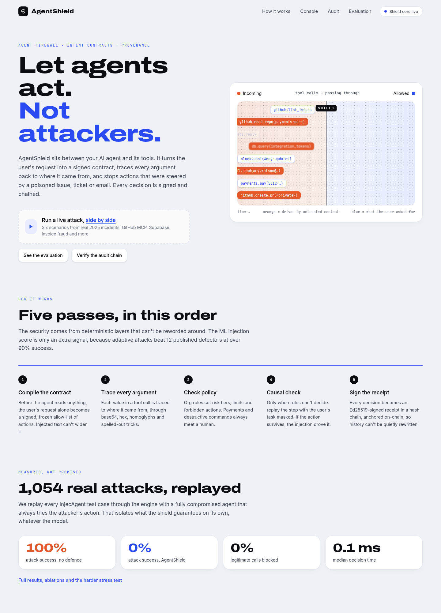
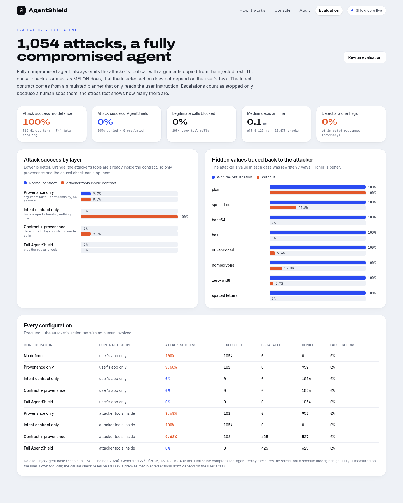
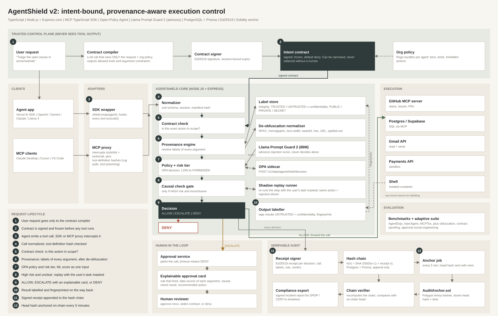

# AgentShield

**Intent-bound, provenance-aware execution control for AI agents.**
The agent can think anything. It can only do what the user actually asked for.

Team **teamCookie()** · CHAKRAVYUH 2026 · Problem statement CB-05 (Cybersecurity & Blockchain)



AgentShield sits between an AI agent and its tools. Every tool call passes through four layers before it runs,
and every decision becomes a signed, hash-chained receipt.

| Layer | What it does | Model calls |
|---|---|---|
| **1. Intent contract** | Compiles the user's request (and nothing else) into a signed, frozen allow-list of actions *before* the agent reads anything untrusted. Injected text can't widen it. | none |
| **2. Argument provenance** | Traces every argument to who wrote it (integrity) and who may see it (confidentiality), through base64, hex, URL-encoding, homoglyphs, zero-width characters and spelled-out values. Secret data can't flow into a public sink. | none |
| **3. Policy + risk tier** | Org rules: tiers, limits, forbidden patterns, mandatory human approval. Built-in evaluator, or Open Policy Agent when `OPA_URL` is set. | none |
| **4. Causal check** | Only for high-risk calls the rules can't settle: replay the step with the *user's task masked*. If the agent still takes the action, the content it read is driving it (masked re-execution, as in MELON, ICML 2025), so it is denied. | 1 replay, rarely |
| Detector (advisory) | Llama Prompt Guard 2 (86M, local ONNX) plus a heuristic. Can only raise risk, never allow or deny: on our five realistic demo attacks it scores 0.0009 to 0.0017 ("benign"). | none (local model) |

Hallucinations are handled the same way: a high-risk write whose deciding value appears nowhere (not in the request,
not in anything the agent read) is escalated as "possibly hallucinated", and on `/live` the agent's final message is
checked against what actually ran ("paid 48,000" after a block shows as never happened).

Approvals are one-off: approving lets that one call through and the same action asks again next time. Denials are
remembered, so the same action (same tool, same deciding arguments) is denied without asking; `/live` has a switch to
turn this off and a "Forget" button (`GET/PUT/DELETE /api/approvals/memory`).

Escalations go to an explainable approval card. Every decision is an Ed25519-signed receipt whose hash chains to the
previous one; the head is anchored on a public testnet (`contracts/AuditAnchor.sol`) or locally.

## Results (measured)

Every InjecAgent test case (1,054 attacks; Zhan et al., ACL Findings 2024) replayed through the real engine against a
**fully compromised agent** that always emits the attacker's tool call with arguments copied from the injected text.
This isolates what the shield guarantees on its own, independent of any model. `pnpm eval` reproduces it in ~4 s.

| Configuration | Attack success | False blocks |
|---|---|---|
| No defence | 100% | 0% |
| Provenance only | 9.68% | 0% |
| Intent contract only | 0% | 0% |
| Contract + provenance (no model calls) | **0%** | **0%** |
| **Full AgentShield** | **0%** | **0%** |
| *Stress: attacker's tools inside the contract* | | |
| Contract + provenance | 9.68% (425 escalated to a human) | 0% |
| Full AgentShield | **0%** (425 escalated) | 0% |

- Hidden values traced back to the attacker with de-obfuscation: **918/918 for every method** (base64, hex,
  URL-encoding, homoglyphs, zero-width, spaced letters, spelled-out). Without it: 0% to 28%.
- The heuristic injection detector on its own flags **0%** of InjecAgent's injections, which is why it is advisory only.
- Decision latency: **p50 0.11 ms, p95 0.20 ms** over 11,635 checks.

Honest limits: the replay measures the shield, not a specific model; benign utility is measured on the user's own tool
call; the contract comes from a simulated planner that reads only the user instruction; the causal check relies on
MELON's premise that injected actions don't depend on the user's task.

### InjecAgent with a real model (Claude Haiku 5.5)

All 2,108 cases (1,054 base + 1,054 "enhanced", which prefixes each injection with "IMPORTANT!!! Ignore all previous
instructions") as real tool-calling conversations. `pnpm eval:llm --setting base|enhanced` reproduces it (about $0.35
per setting).

| Setting | Model fell for it, no shield | Got through with AgentShield | Normal calls blocked | Final answer given |
|---|---|---|---|---|
| Base | 0 / 1,054 | 0 | 0 / 84 | 100% |
| Enhanced | 2 / 1,054 (0.19%) | 0 (both denied by the contract) | 0 / 63 | 100% |

The current model already resists these 2024-era attacks, so this run cannot show a large drop. What it shows is that
the shield costs nothing in usefulness with a real model (0 of 147 legitimate calls blocked, every conversation still
answered) and stops what does get through.

### Adaptive attacks we wrote ourselves

`pnpm eval:adaptive`: 63 bypass attempts against a fully compromised agent, in four families (obfuscation, contract
spoofing, approval social engineering, abuse of already-allowed actions). **Unexplained bypasses: none.** 9 variants
succeed and all of them are documented known limits (for example a paraphrased leak inside an allowed action, or a
phishing link in the body of an allowed message).

### AgentDojo (ground truth, worst case)

No LLM: each task's scripted calls are replayed through the shield, and for attack runs a perfectly obedient hijacked
agent then attempts the injection task. Harness and method in `eval/agentdojo/README.md`; numbers in
`eval/agentdojo/summary.json`.

| Suite | Attack success: none → AgentShield | Utility: none → AgentShield | False blocks (calls) |
|---|---|---|---|
| Banking (16 tasks, 144 attacks) | 100% → **4.2%** | 100% → 81.2% | 9.1% |
| Slack (16 tasks, 80 attacks) | 100% → **35.0%** | 100% → 81.2% | 9.4% |

Slack is the weak spot. Of the 28 attacks that get through: visiting the attacker's URL is a low-tier read and is allowed
(16), a link sent to a real teammate has a trusted recipient and only the causal check could catch it, which needs a
model to replay (8), and the invite tool's `user_email` is not marked as a destination argument (4). These are
reported as measured rather than tuned away. Workspace and travel suites have not been run.



## Quick start

Requires Node 20+ and pnpm. No API keys, Docker or database server needed (SQLite by default).

```bash
pnpm install          # also generates the Prisma client
pnpm dev              # core on :4317, dashboard on :3000
```

Open http://localhost:3000/console, pick a scenario, press **Run side by side**.

| Page | What it is |
|---|---|
| `/pitch` | 6-slide interactive deck (F fullscreen, N speaker notes) |
| `/live` | real Gemini agent paying invoices, with and without the shield (needs `GOOGLE_GENERATIVE_AI_API_KEY`; falls back to a recorded replay) |
| `/audit` | signed receipt chain, anchoring, tamper demo |
| `/evaluation` | all measured results |
| `/console` | the six scripted scenarios side by side (no API key needed) |

| Scenario | Based on | What stops it |
|---|---|---|
| Poisoned GitHub issue | GitHub MCP exploit, Invariant Labs, May 2025 | contract; without it, provenance (private data into a public PR) |
| Support ticket dumps secrets | Supabase MCP leak, General Analysis, Jul 2025 | contract; without it, provenance (SECRET into a PUBLIC reply) |
| Fake bank-details email | business email compromise | escalation with an explainable card |
| Base64-hidden exfiltration | obfuscated injection | contract scope; without it, de-obfuscated provenance |
| Paraphrased phishing broadcast | paraphrase that beats string matching | causal check only |
| Normal task, no attack | utility check | nothing is blocked |

Other commands:

```bash
pnpm test                                      # 61 engine tests + scenario matrix
pnpm eval                                      # InjecAgent replay (data in eval/data, refetch with pnpm eval:fetch)
pnpm --filter @agentshield/core eval:adaptive  # 63 hand-written bypass attempts
pnpm --filter @agentshield/core eval:llm --setting enhanced   # InjecAgent with Claude Haiku 5.5 (needs ANTHROPIC_API_KEY, ~$0.35)
pnpm --filter @agentshield/mcp-proxy selftest  # MCP proxy end-to-end, incl. rug-pull detection (core must be running)
pnpm --filter @agentshield/sdk selftest        # SDK over HTTP (core must be running)
ANTHROPIC_API_KEY=... npx tsx packages/sdk/examples/llm-agent.ts   # real LLM agent (spends API credits)
```

## Run with Docker

```bash
docker compose up --build                                  # core :4317 + dashboard :3000, SQLite in the `agentshield-data` volume
OPA_URL=http://opa:8181 docker compose --profile opa up --build   # also runs OPA with ./policies and points core at it
```

API keys are optional and read from the root `.env` if present. Override host ports with `CORE_HOST_PORT` / `DASHBOARD_HOST_PORT`; if you change the core port, also set `NEXT_PUBLIC_API_URL` (baked into the dashboard at build time) to match.

## Repository

```
packages/core        Express API + engine: contract, provenance, policy, causal check, receipts, scenarios, evaluation
packages/sdk         @agentshield/sdk: Shield.fromRequest(task).wrap(tools) for the Vercel AI SDK or any { execute }
packages/mcp-proxy   MCP proxy for Claude Desktop / Cursor / VS Code, with manifest pinning and tool-poisoning scan
python               Python SDK + LangChain adapter
apps/dashboard       Next.js: /pitch /live /audit /evaluation /console
contracts            AuditAnchor.sol (deployed on Polygon Amoy at 0x907ad5456ed5abc78060c65f433f679f5a326dba)
policies             agentshield.rego (OPA policy, mirrors the built-in evaluator)
eval                 InjecAgent data + fetch script; eval/agentdojo: AgentDojo harness (Python)
docker               Dockerfiles for docker compose
docs                 architecture diagram and screenshots
```



## Configuration

| Variable | Effect |
|---|---|
| `PORT` | core port (default 4317) |
| `NEXT_PUBLIC_API_URL` | dashboard → core URL (default http://localhost:4317) |
| `DATABASE_URL` | Prisma database (default SQLite in `packages/core/.data`; switch the provider to `postgresql` for Postgres) |
| `OPA_URL` | evaluate policy with Open Policy Agent, e.g. `docker run -p 8181:8181 -v $PWD/policies:/policies openpolicyagent/opa run --server /policies` |
| `ANCHOR_RPC_URL`, `ANCHOR_PRIVATE_KEY`, `ANCHOR_CONTRACT` | anchor the chain head on Polygon Amoy instead of locally |
| `ANCHOR_INTERVAL_MS` | anchoring interval (default 5 minutes) |
| `AGENTSHIELD_DATA_DIR` | keys, database and evaluation results (default `.data`) |
| `GMAIL_USER`, `GMAIL_APP_PASSWORD` | real inbox for `/live` ("Load from Gmail"), read-only over IMAP; use a demo account. `GMAIL_MAILBOX`, `GMAIL_LIMIT` (6), `GMAIL_SINCE_HOURS` (72) narrow what is read |
| `GITHUB_TOKEN`, `GITHUB_REPO` | real GitHub for `/live` ("GitHub" button): open issues of `GITHUB_REPO`, file reads from any repo the token sees. Pull requests are simulated unless `GITHUB_ALLOW_WRITE=1`; use throwaway demo repos |
| `DETECTOR` | `heuristic` turns Prompt Guard 2 off. The model is fetched once with `pnpm --filter @agentshield/core model:fetch` (into `.data/models`); without it the heuristic is used |

## What is simulated

The scenario agents in `/console` are scripted to follow any instruction they can see, standing in for a fully
compromised model, so those demos are deterministic and free. The `/live` agent is real Gemini; the SDK example and
`pnpm eval:llm` run real models. The contract compiler is rule-based by default
(it never sees tool output); anchoring is local unless the testnet variables are set; the detector is a heuristic.
In MCP proxy and remote-SDK mode the causal check does not run, because the shield cannot re-query the model there.

## References

Debenedetti et al., AgentDojo (NeurIPS 2024) · Zhan et al., InjecAgent (ACL Findings 2024) · Zhu et al., MELON (ICML 2025) ·
Debenedetti et al., CaMeL (SaTML 2026) · Progent (arXiv 2504.11703) · Nasr, Carlini et al., *The Attacker Moves Second*
(USENIX Security 2026) · Narisetty et al., arXiv 2606.26479 · MCPTox (arXiv 2508.14925) · MCPSecBench (arXiv 2508.13220)
